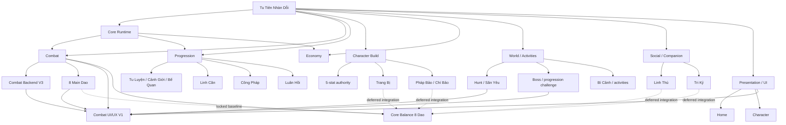

# GAME MASTER MAP — TU TIÊN NHÀN DỖI

Status: **ACTIVE PROJECT CONTROL MAP**  
Updated: 2026-10-05  
Gameplay baseline at map creation: `43f10efd1406ecde843808a4d8a8e5cc092097ba`

This is the one-page map of the game. It is not a replacement for `CURRENT_CHECKPOINT.md`, contracts, tests, or live source.

Use it to answer:
- the game is split into which major modules;
- which module is locked, live, active, deferred, legacy, or needs rework;
- which module owns the next task;
- what depends on what.

## Status legend

| Status | Meaning |
|---|---|
| CLOSED / LOCKED | Accepted production authority. Regression-only unless explicitly reopened. |
| LIVE | Current authority is in production, but the module is not necessarily feature-frozen. |
| ACTIVE | Current planned/implementation slice. |
| READY | Candidate prepared; closure evidence still required. |
| REWORK PLANNED | Existing system remains usable/legacy, but a redesign/production pass is planned. |
| DEFERRED | Intentionally not being worked on now. |
| LEGACY / COMPAT | Retained only for compatibility/history while dependencies remain. |
| AUDIT NEEDED | Exists, but current authority/status must be traced before redesign. |

## Current project milestone

**Combat foundation: 8/8 Main Dao CLOSED / LOCKED.**

- Kiếm
- Quyền
- Thể
- Thần Niệm
- Pháp
- Độc
- Trận
- Ngự Khí

Formation and Artifact/Ngự Khí were both user-accepted on exact SHA
`43f10efd1406ecde843808a4d8a8e5cc092097ba`.

**Current active product priority: Combat UI/UX V1.**

Core Balance 8 Đạo and auxiliary-system reworks are intentionally deferred until explicitly opened.

## Project dependency map



## Major module registry

| Major module | Status | Control file | Current note |
|---|---|---|---|
| Core Runtime | CLOSED / LOCKED + LIVE compatibility | `docs/systems/core-runtime/MODULE.md` | JS runtime/save/gameplay authority remains canonical. |
| Combat | ACTIVE presentation phase | `docs/systems/combat/MODULE.md` | Backend + 8 Dao locked; Combat UI/UX is next. |
| Progression | LIVE / mixed | `docs/systems/progression/MODULE.md` | Linh Căn V145 explicitly live; other submodules route to live source/tests before redesign. |
| Character Build | LIVE / REWORK PLANNED | `docs/systems/character-build/MODULE.md` | Equipment/auxiliary combat systems are not part of current UI slice. |
| Economy | LIVE / AUDIT NEEDED per submodule | `docs/systems/economy/MODULE.md` | Preserve source/sink and Săn Ảo semantics until opened. |
| World / Activities | LIVE / mixed | `docs/systems/world-activities/MODULE.md` | Hunt/Boss are dependencies of Combat UI. |
| Social / Companion | REWORK PLANNED / DEFERRED | `docs/systems/social-companion/MODULE.md` | Tri Kỷ/Linh Thú not included in current balance/UI scope unless explicitly opened. |
| Presentation / UI | ACTIVE | `docs/systems/presentation/MODULE.md` | Combat UI/UX V1 is current active presentation module. |

## Current execution order

1. **Combat UI/UX V1**
2. Combat playable presentation / runtime visual approval
3. Core Balance 8 Đạo — only when explicitly opened
4. Rework auxiliary systems one by one
5. Integrate each reworked auxiliary system with measured regressions
6. Final whole-build/global balance after the participating systems are productionized

This ordering is planning authority only. A new explicit user instruction may change it.

## Control hierarchy

```text
GAME_MASTER_MAP.md
        │
        ├── CURRENT_CHECKPOINT.md
        │       └── what is active RIGHT NOW
        │
        └── docs/systems/INDEX.md
                │
                └── docs/systems/<module>/MODULE.md
                        │
                        ├── active DESIGN / CONTRACT
                        ├── AUTHORITY / source owners
                        ├── TEST / gate
                        └── CLOSURE / evidence
```

Rules:
- Master Map answers **where the system belongs**.
- Checkpoint answers **what is currently happening**.
- MODULE.md answers **who owns this subsystem and what its state is**.
- Detailed contract/spec answers **how it must behave**.
- Tests/gates prove implementation.
- Closure record proves accepted exact candidate.

Do not copy full contracts into the Master Map.
